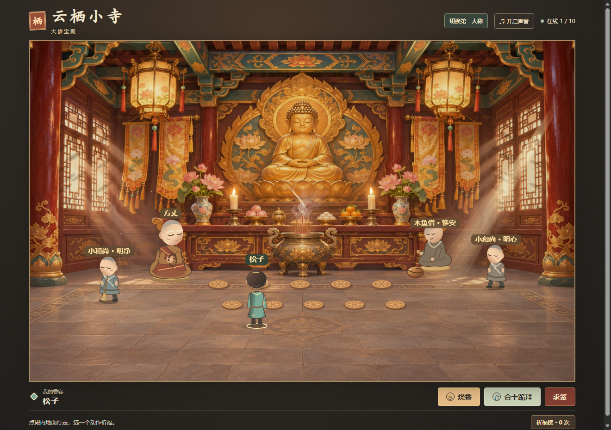

# 云栖小寺

一座最多容纳 10 位在线玩家的国风小寺。点地面行走，选择烧香或跪拜，角色会走到最近的空蒲团，持续祈福。殿内可以切换第一、第三人称视角，听木鱼和钟声，也可以求签、查看祈福榜。

## 在自己的电脑上玩

安装 Node.js 24 后，下载并解压项目。在 Windows 上双击 `启动游戏.cmd`，浏览器会自动打开游戏。游玩时保持启动窗口打开。

在 macOS 或 Linux 上，进入解压后的目录，运行 `node server.js`，然后打开终端显示的本机地址。

## 多人运行

在 Linux 服务器的项目目录运行 `HOST=0.0.0.0 PORT=8766 node server.js`。玩家通过同一个可访问的服务地址进入同一座大殿。运行时会自动创建 `data/prayers.sqlite` 保存祈福记录，更新游戏时请保留该文件。
